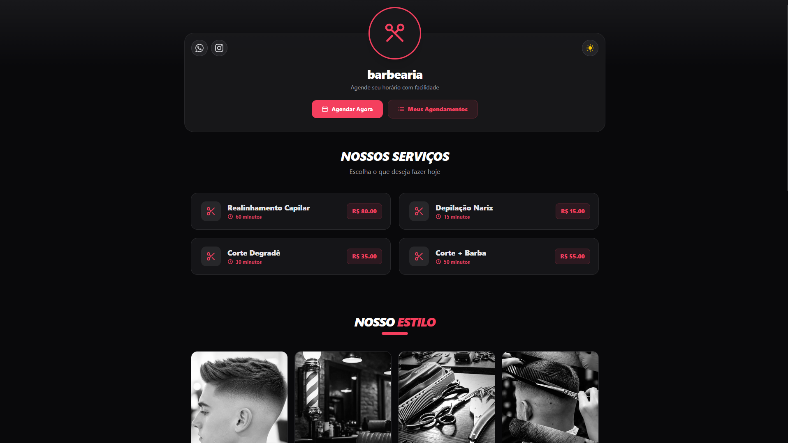
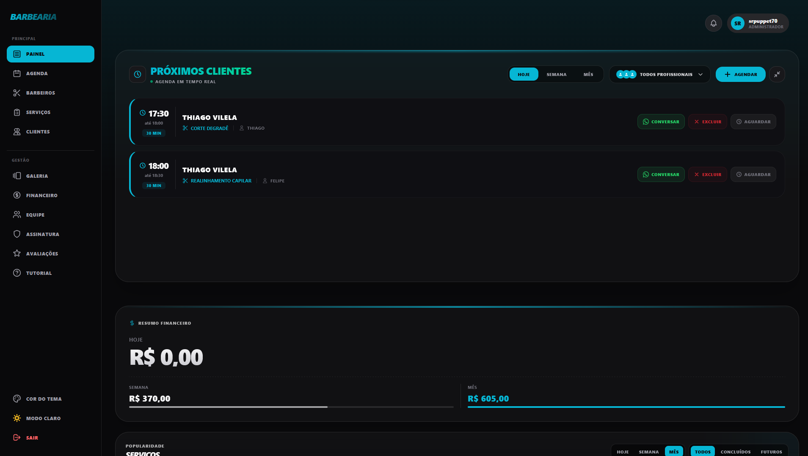
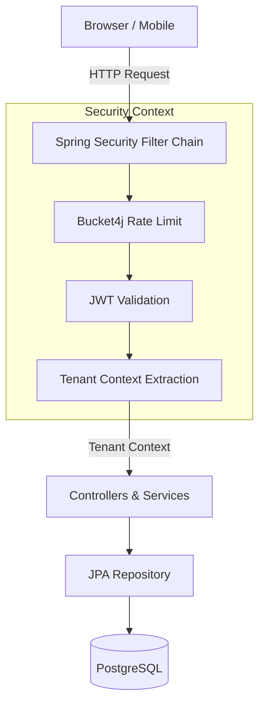

# Agendout — Sistema SaaS de Gestão e Agendamento para Barbearias

O **Agendout** é uma plataforma SaaS desenvolvida para facilitar a gestão de barbearias, oferecendo ferramentas para agendamento online, controle financeiro, gerenciamento de equipes e acompanhamento de resultados.

O sistema utiliza uma arquitetura **Multi-Tenant**, permitindo que diferentes estabelecimentos utilizem a mesma plataforma de forma independente, com personalização e isolamento de dados.

> **Nota sobre o código-fonte:** Este repositório funciona como uma vitrine técnica do projeto. Por se tratar de um sistema em produção, o código-fonte completo, as configurações de infraestrutura e determinadas regras de negócio permanecem em um repositório privado.

## Demonstração

Confira o sistema em funcionamento e explore suas interfaces:

| Recurso | Acesso |
| :--- | :--- |
| **Site oficial** | [agendout.com.br](https://agendout.com.br) |
| **Booking Page** | [Experimentar agendamento](https://agendout.com.br/barbearia) |
| **Galeria de screenshots** | [Visualizar galeria completa](https://thiagopvileladev.github.io/agendout-portfolio/) |

---

## Telas do Sistema

O frontend foi desenvolvido com foco em usabilidade, responsividade e facilidade de navegação, permitindo que os clientes realizem agendamentos diretamente pelo navegador, sem precisar instalar um aplicativo.

As capturas de tela e demonstrações das interfaces estão disponíveis na [galeria visual do Agendout](https://thiagopvileladev.github.io/agendout-portfolio/).

| Página de Agendamento | Painel Administrativo |
| :---: | :---: |
|  |  |

---

## Tecnologias Utilizadas

O projeto utiliza uma arquitetura baseada em uma aplicação frontend independente, integrada a uma API RESTful responsável pelas regras de negócio e persistência dos dados.

### Backend

- **Java 17 e Spring Boot 3.2.4:** desenvolvimento da API e das regras de negócio.
- **Spring Security e OAuth2:** autenticação e controle de acesso utilizando JWT.
- **JPA e Hibernate 6:** persistência e gerenciamento dos dados.
- **Bucket4j:** controle de requisições e rate limiting.
- **Apache POI:** geração e exportação de relatórios financeiros em Excel.
- **Jsoup:** sanitização de conteúdo e prevenção contra ataques XSS.

### Frontend

- **React e Vite:** construção da interface e gerenciamento da aplicação.
- **Tailwind CSS:** estilização e implementação da identidade visual.
- **Recharts:** apresentação de gráficos e indicadores financeiros.
- **Framer Motion:** animações e transições da interface.

### Infraestrutura

- **PostgreSQL:** banco de dados relacional.
- **Supabase:** gerenciamento do banco de dados e armazenamento de arquivos.
- **Supabase Storage:** armazenamento de imagens, logotipos e arquivos otimizados em WebP.
- **Render:** hospedagem da API.
- **Cloudflare Pages:** hospedagem do frontend.

---

## Arquitetura Multi-Tenant

Um dos principais pontos do projeto é a implementação de uma arquitetura multi-tenant, que permite atender diferentes barbearias utilizando a mesma aplicação e estrutura de banco de dados.

Foi utilizada a abordagem de **Row-Level Tenancy (Discriminator Column)**, na qual os registros são associados a um identificador de tenant, garantindo a separação dos dados entre os estabelecimentos.

### Fluxo de requisições

### Isolamento e controle de acesso

**Resolução do Tenant:** Um filtro customizado identifica o tenant responsável pela requisição, utilizando informações disponíveis nos cabeçalhos HTTP, nas rotas da API ou no token JWT.

**Contexto de Segurança:** O identificador do tenant é disponibilizado durante o processamento da requisição, permitindo que as operações de persistência considerem o contexto do estabelecimento.

**Controle de Assinaturas:** O sistema verifica a situação da assinatura antes de liberar determinadas funcionalidades. Estabelecimentos com pagamento suspenso têm o acesso restrito, mantendo disponíveis as rotas necessárias para gerenciamento de cobrança e assinatura.

---

## Segurança e LGPD

A segurança foi considerada durante o desenvolvimento da aplicação, com implementação de mecanismos de proteção para autenticação, autorização, tratamento de dados e controle de requisições.

Entre as principais implementações estão:

- **Autenticação com Google OAuth2:** integração com login do Google e geração de cookies HttpOnly e Secure para gerenciamento de sessão.
- **Proteção contra força bruta e spam:** utilização de filtros de requisição e Bucket4j para limitar tentativas e identificar comportamentos abusivos.
- **Criptografia de dados sensíveis:** utilização de um conversor customizado para proteger informações como CPF e CNPJ armazenadas no banco de dados.
- **Blind Indexing:** utilização de hashes determinísticos para permitir consultas indexadas de documentos sem armazenar seus valores originais em texto claro.
- **Proteção CSRF:** implementação de mecanismos de proteção contra requisições não autorizadas.
- **Cabeçalhos de segurança:** configuração de políticas como HSTS, Content Security Policy e Referrer Policy.
- **Soft Delete:** implementação de exclusão lógica para preservar a integridade e o histórico dos registros.

---

## Principais Funcionalidades

### 1. Pagamentos e Assinaturas

Integração com a API do Asaas para gerenciamento das assinaturas da plataforma.

O fluxo contempla:

- Geração de cobranças via PIX.
- Processamento de pagamentos por Webhooks.
- Atualização automática do status das assinaturas.
- Gerenciamento de planos e ciclos de cobrança.
- Controle de acesso conforme a situação do pagamento.

### 2. Agendamento Online

Sistema de agendamento que permite aos clientes visualizar os horários disponíveis e reservar serviços diretamente pela página do estabelecimento.

A lógica considera:

- Horários de funcionamento.
- Disponibilidade individual dos profissionais.
- Duração dos serviços.
- Intervalos entre atendimentos.
- Folgas e bloqueios de agenda.
- Prevenção de conflitos de horários (Double Booking).

### 3. Gestão Financeira

Módulo administrativo para acompanhamento dos resultados do estabelecimento, incluindo:

- Controle de receitas.
- Acompanhamento financeiro.
- Gerenciamento de comissões.
- Relatórios e indicadores.
- Exportação de dados para Excel.

### 4. Controle de Acesso (RBAC)

Implementação de controle de acesso baseado em funções, com diferentes níveis de permissão:

- **SUPERADMIN:** gerenciamento geral da plataforma.
- **ADMIN:** gerenciamento do estabelecimento.
- **EMPLOYEE:** acesso às funcionalidades permitidas para funcionários.
- **USER:** acesso às funcionalidades destinadas aos clientes.

As permissões também consideram o status da assinatura do estabelecimento, evitando que usuários vinculados a uma barbearia suspensa continuem acessando o painel administrativo.

---

## Sobre o Desenvolvimento

O Agendout foi idealizado e desenvolvido por mim, desde a modelagem do banco de dados e implementação do backend até a construção do frontend, integração dos serviços externos e configuração da infraestrutura de produção.

O desenvolvimento envolveu decisões relacionadas à arquitetura de software, segurança, isolamento de dados, autenticação, integrações de pagamento e organização de uma aplicação SaaS multi-tenant.

**Status do projeto:** Em produção.
